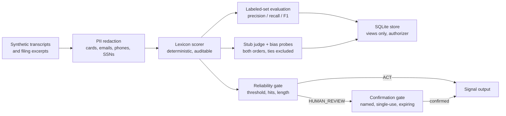

# Architecture

Reading rule: application code reads `v_documents` and `v_scores`
only. The authorizer enforces that at the database layer, not by
convention. Seeding happens before the authorizer is installed.

See also `knowledge/architecture.md` for the same diagram with
notes on each component.
