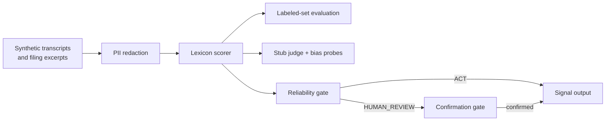
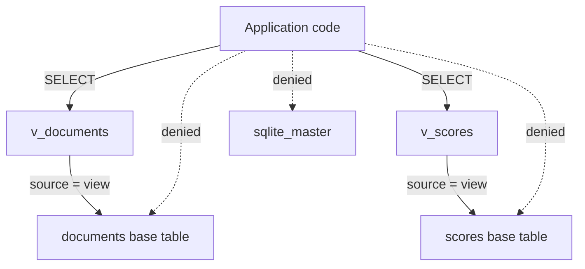

# Architecture notes (Mermaid)

## Pipeline

## Store access

Notes:

- The scorer is deterministic: same text, same score, always.
  That is a feature for audit, and a limitation for language
  understanding (see `docs/limitations.md`).
- The gate sits between scoring and any consumer. There is no
  code path from scorer to output that skips it.
- The judge never writes scores and never creates approvals. It
  only labels, so a compromised or biased judge cannot by itself
  move a signal to action.
- The fictional firm used in examples is Hollowbrook Capital, an
  invented investment research firm. It is not a real business,
  and no example in this repo describes a real company.
